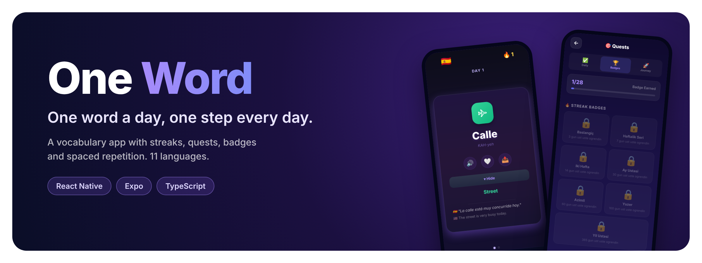
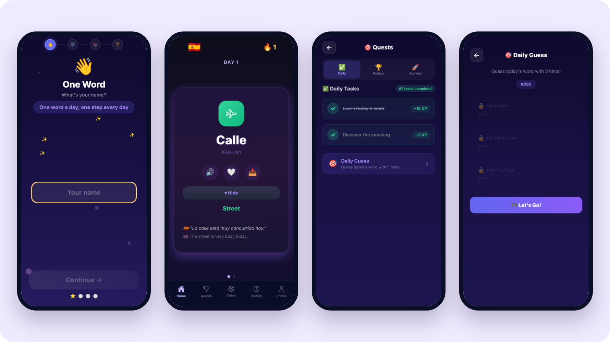
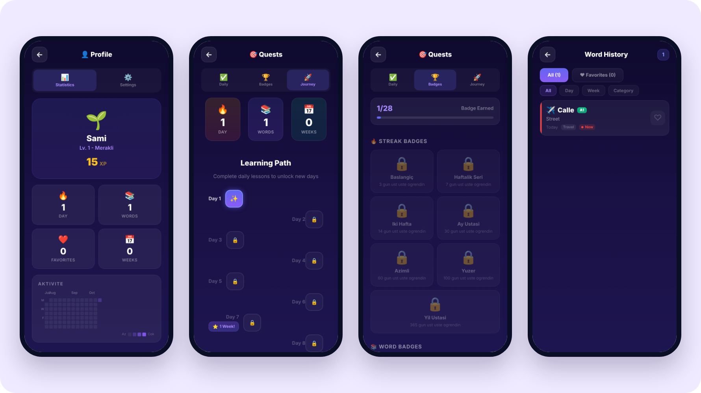

<p align="center">
  
</p>

<p align="center">
  <b>A mobile app that teaches you one new word every day.</b><br>
  Small daily habit, streaks and quests to keep you going, spaced repetition so the words stick.
</p>

<p align="center">
  
  
  
  
  
</p>

<p align="center">
  <a href="#-what-it-does">Features</a> ·
  <a href="#-screens">Screens</a> ·
  <a href="#-under-the-hood">Under the hood</a> ·
  <a href="#-run-it-locally">Run locally</a> ·
  <a href="#-nederlands">Nederlands</a>
</p>

---

## ✨ What it does

Learning a language often fails on consistency, not difficulty. One Word keeps the daily step tiny, one word with its
pronunciation and an example sentence, and wraps it in game mechanics that make you come back tomorrow.

<table>
<tr>
<td width="50%" valign="top">

### 📚 Learn
- One word a day on a card: pronunciation, meaning and an example sentence
- Hear the word spoken (text-to-speech)
- Three levels (beginner, intermediate, advanced) and topic categories
- 365 words for each of the 11 target languages

</td>
<td width="50%" valign="top">

### 🔁 Remember
- **Spaced repetition** based on the SM-2 algorithm: words come back right before you would forget them
- Review sessions and quizzes on the words you learned
- Word history with favourites and filters by day, week or category

</td>
</tr>
<tr>
<td valign="top">

### 🎯 Stay motivated
- Day streaks with an activity heatmap
- Daily quests with XP and levels
- 28 badges for streaks, words and quests
- **Daily Guess**: guess today's word from three hints
- Weekly challenge and weekly summary

</td>
<td valign="top">

### 💬 Practice and share
- Conversation practice in everyday scenarios (café, travel, work…) with quick replies and gentle corrections
- Share a word or an achievement as an image card
- Daily reminder notifications
- Interface in 11 languages

</td>
</tr>
</table>

---

## 📸 Screens

<p align="center">
  <br>
  <sub><b>Learn</b>: onboarding, today's word with meaning and example, daily quests, Daily Guess</sub>
</p>

<p align="center">
  <br>
  <sub><b>Progress</b>: profile with XP and activity heatmap, learning path, badges, word history</sub>
</p>

---

## 🛠 Under the hood

| | |
|---|---|
| **App** | React Native 0.81 with Expo SDK 54, TypeScript |
| **Storage** | AsyncStorage: progress, streaks, favourites and repetition data stay on the device, no account needed |
| **Content** | One JSON file per language in `src/data/content/`, 365 words each with level, category, pronunciation and example |
| **Spaced repetition** | `src/utils/srs.ts`, an SM-2 implementation that schedules each word's next review |
| **Practice chat** | `src/services/aiChat.ts`: scenario-based replies picked by the word's category, in the learner's language |
| **Native features** | `expo-speech` (pronunciation), `expo-notifications` (reminders), `expo-haptics`, `react-native-view-shot` (share cards) |

### Project layout

```
App.tsx                  Entry point and navigation between screens
src/
├── screens/             Home, Onboarding, Quests, Review, Quiz, Practice, History, Profile, …
├── components/          Daily Guess game, badge modal, streak heatmap, share cards, …
├── data/content/        Words per language (en, es, de, fr, it, pt, ru, ja, ko, zh, tr)
├── services/aiChat.ts   Practice conversation logic
└── utils/               Spaced repetition, XP and levels, badges, quests, translations, storage
docs/                    README images
```

---

## 🚀 Run it locally

You need Node.js 18 or newer.

```bash
git clone https://github.com/samigulec/One-Word.git
cd One-Word
npm install
npx expo start
```

Scan the QR code with **Expo Go** on your phone, or press `w` to open the web version in your browser.

---

## 🤖 How it was built

Designed and built by **Sami Güleç** together with [Claude](https://claude.ai) as an AI pair programmer:
I decide what the app needs and test every change, Claude helps write and refine the code.

---

## 🇳🇱 Nederlands

**One Word** is een mobiele app waarmee je elke dag één nieuw woord leert.

- Elke dag één woord met uitspraak, betekenis en voorbeeldzin, in 11 talen
- Herhaling volgens het SM-2-algoritme, zodat woorden blijven hangen
- Streaks, dagelijkse opdrachten, XP, 28 badges en een dagelijks raadspel
- Oefengesprekken in alledaagse situaties
- Gebouwd met React Native, Expo en TypeScript; alle gegevens blijven op het toestel

Gemaakt door Sami Güleç, AI-first ontwikkeld samen met Claude.

## 📜 License

MIT, see [LICENSE](LICENSE).
